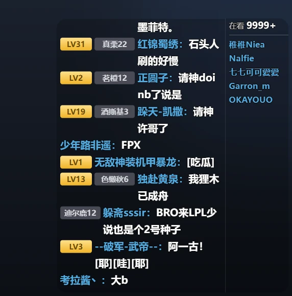
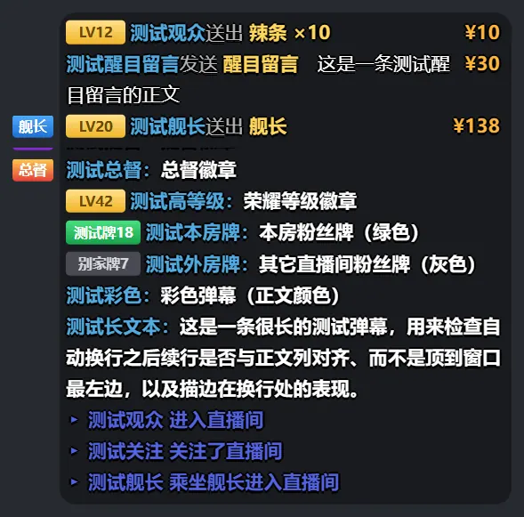
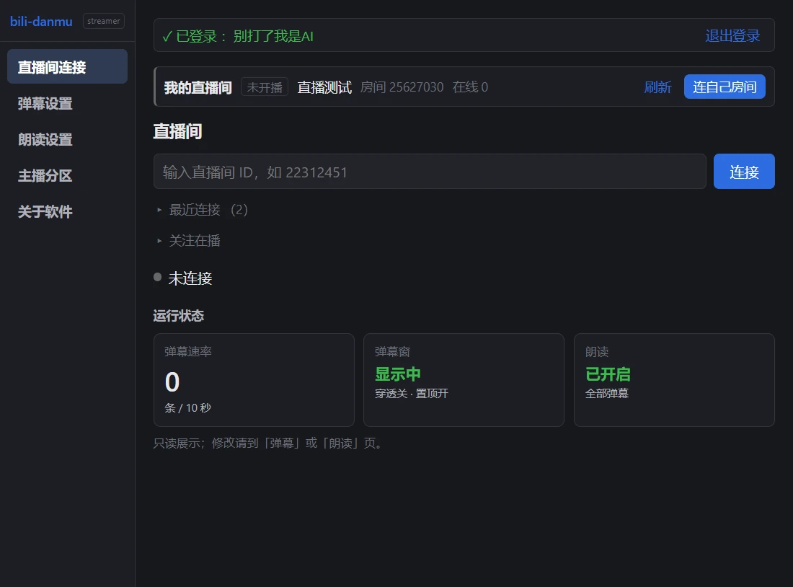
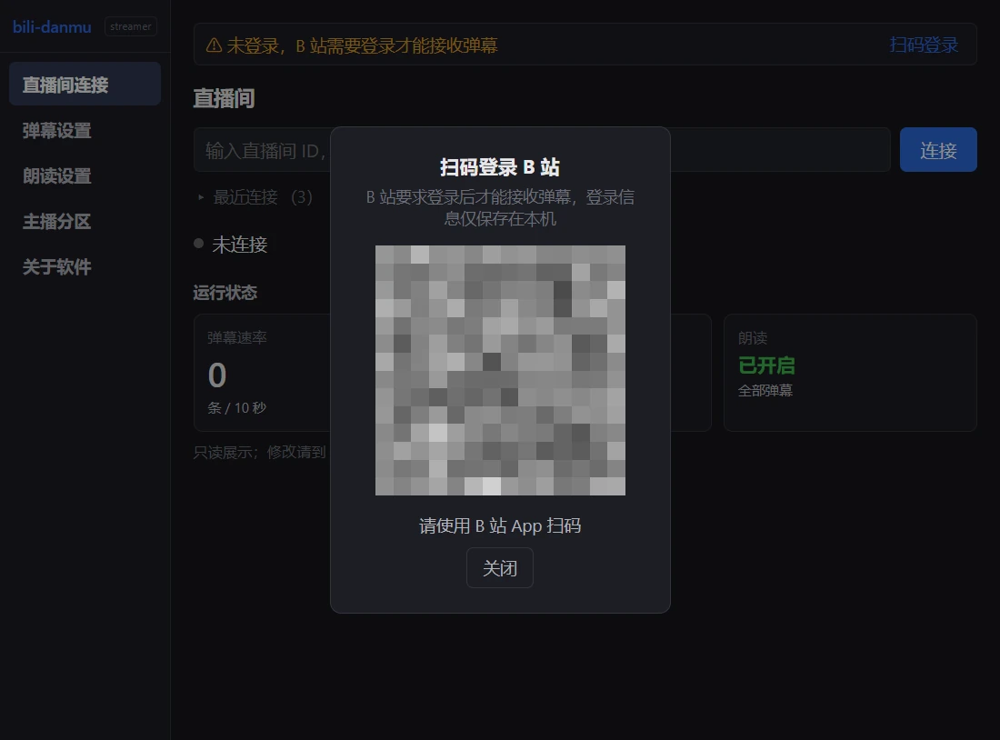
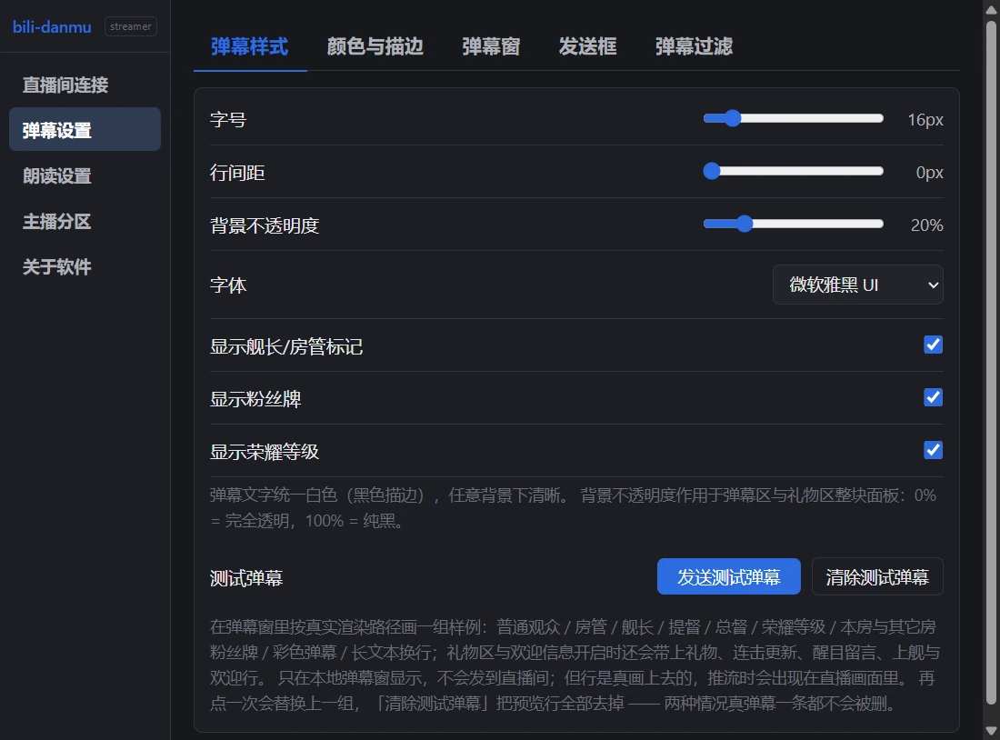
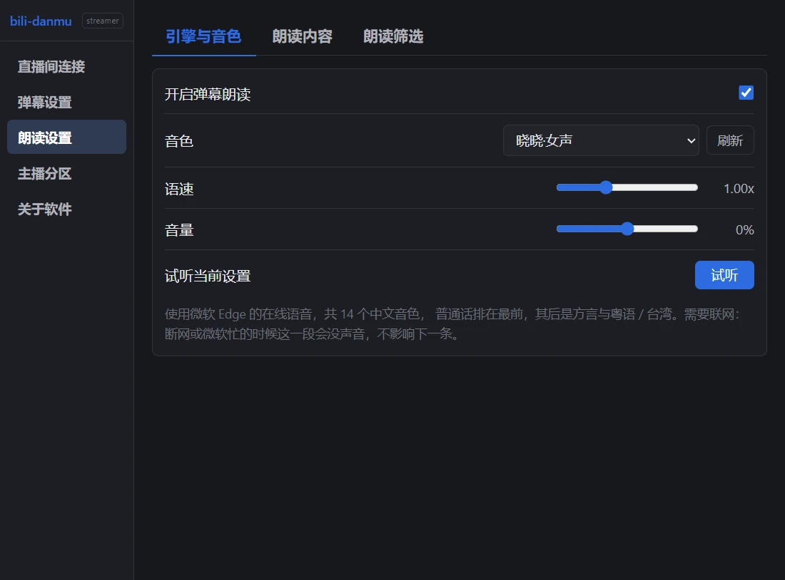
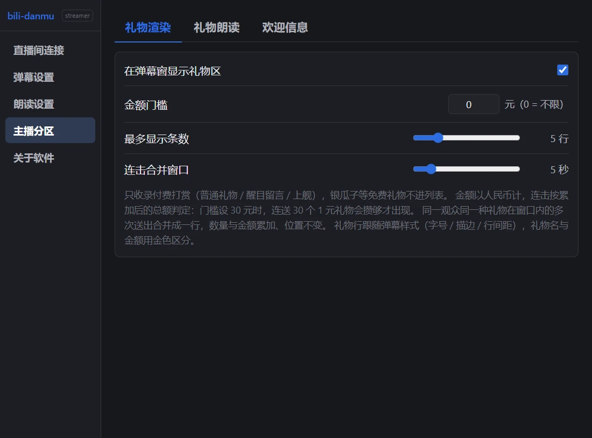
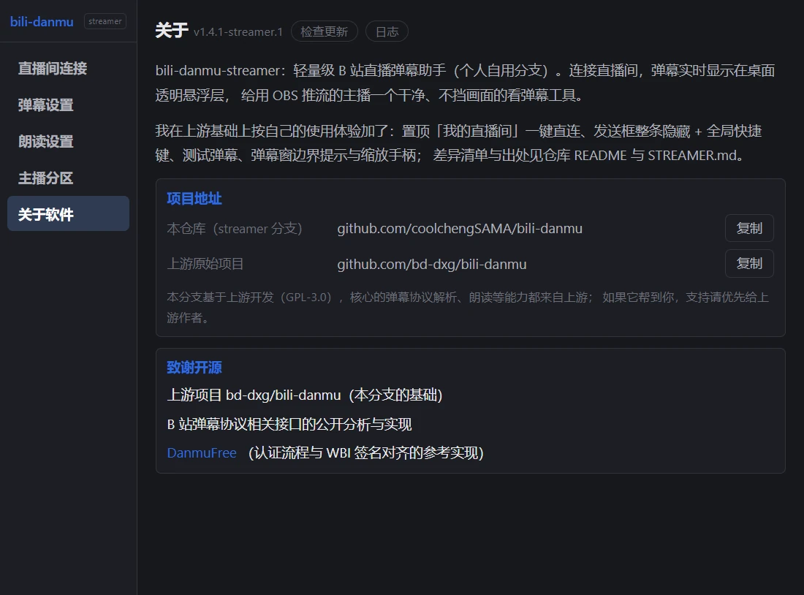
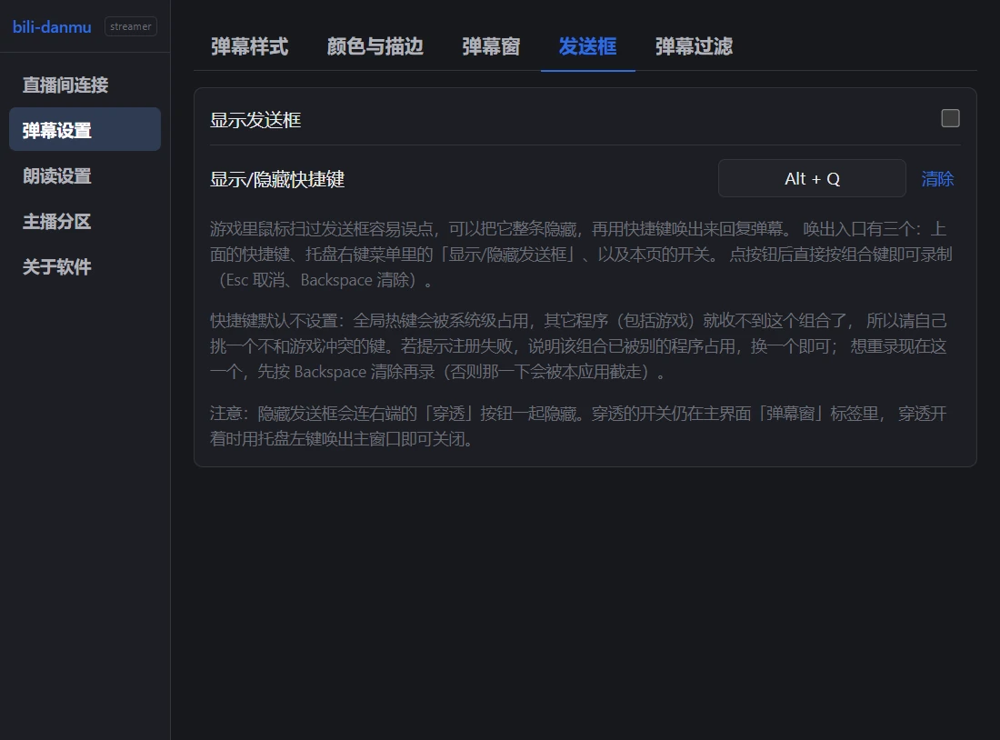

 bili-danmu-streamer

3 MB 的安装包，一个不跟游戏抢资源的 B 站弹幕助手（自用分支）

> **本仓库是 [bd-dxg/bili-danmu](https://github.com/bd-dxg/bili-danmu) 的 fork**，主线是**个人自用分支**（`streamer`）：按我自己使用中的体验来改与加功能。与上游的差异见下方「streamer 分支差异」，完整清单与回退方式见 [`STREAMER.md`](./STREAMER.md)；安装包见[本仓库 Releases](https://github.com/coolchengSAMA/bili-danmu/releases)。
> **上游是原始项目**：本版基于上游开发（核心的弹幕协议解析、朗读等能力都来自上游），出处与许可证保留在 [`STREAMER.md`](./STREAMER.md) 与 `LICENSE`；**如果它帮到你，支持请优先给[上游作者](https://github.com/bd-dxg/bili-danmu)**。

## streamer 分支差异

这些改动都来自我自己的使用体验（在上游基础上），细节与回退方式见 [`STREAMER.md`](./STREAMER.md)）：

| 改了什么 | 为什么 |
|---|---|
| **「我的直播间」置顶卡片**：显示自己房间的标题、开播状态、在线人数，一键直连自己房间 | 我开播时每天连的都是同一个房间，这是最高频路径；上游新加的「关注在播」我基本用不到 |
| **最近连接 / 关注在播 折叠**（默认收起，展开即用） | 可以看其他账号的直播间弹幕 |
| **发送框可整条隐藏 + 全局快捷键唤出**（含右端「穿透」按钮） | 游戏里鼠标扫过发送框容易误点，尤其是没有锁定鼠标的射击游戏 |
| **测试弹幕**：一键在弹幕窗里画一组样例（房管 / 舰长 / 提督 / 总督 / 荣耀等级 / 粉丝牌 / 彩色 / 换行 + 礼物 / 醒目留言 / 上舰 / 欢迎行），可一键清除 | 调样式、改徽章列宽时能立刻看到真实渲染效果 |
| **弹幕窗左侧边界提示 + 缩放手柄** | 左侧留白是头衔列，鼠标移入时提示边界；虚线同时是缩放手柄（系统热区只在窗口最外缘 3px，够不着） |
| 修复：按住右键拖出窗口不再弹 WebView2 菜单；输入框未登录时给出禁用提示 | 上游 issue #37 / PR #38 / #39 |
| 性能：热键切换不再每按一下写一次配置 | 写盘是整份配置 + DPAPI 加解密，而热键回调在主线程 |

## 开发背景

- 上游项目 [bd-dxg/bili-danmu](https://github.com/bd-dxg/bili-danmu) 的起因是：老弹幕助手早已停更、B 站协议更新后收不到弹幕，而现存的助手要么框架臃肿、要么资源占用高。于是它把这件事重做了一遍：给用 OBS 推流的主播一个不挡游戏画面的看弹幕窗口。
- **本仓库是它的 fork**：上游已经把「轻量 + 不挡画面」做得很到位，我这边只是按**自己直播时的使用体验**继续改与加功能（差异见上方表格），代码差异保持薄、可枚举、可回退。
- 感谢开源社区：弹幕协议相关接口的公开分析与实现，以及 [DanmuFree](https://github.com/SoraYjy/DanmuFree) 的开源参考。

## 亮点

- **小**：安装包 3 MB，装完占硬盘 13 MB。不用额外装浏览器组件（Windows 自带）、不用装 Python、不用下载语音模型，双击下一步就能用。
- **不跟游戏抢电脑**：直播时游戏已经满负荷，助手不该再压上一块石头。内存占用很小，长时间挂着也不会越来越多；鼠标穿透一开，弹幕窗不拦鼠标，点击直接落到游戏上。
- **故意没做的功能**：没有用户头像、没有礼物图标，一行弹幕就是一行字；没有花哨动画，弹幕淡入进场不影响画面拖动；不打赏刷屏，同一个人送同一件礼物合并成一行显示总数量。
- **挂着就行**：断线自动重连，重连期间不弹报错、不刷屏；弹幕最多留 120 条，超出挤掉最早的，看一整天也不会卡。

挂着直播时，任务管理器里的占用

## 效果

弹幕窗透明，直接叠在游戏画面上；礼物行金色区分、连击只占一行；右侧是「在看人数 + 实时在线榜」；下方是发送框，回车发送

测试弹幕：在弹幕样式页点一下，就在弹幕窗里按真实渲染路径画一组样例 —— 房管 / 舰长 / 提督 / 总督、荣耀等级、本房与其它房粉丝牌、彩色弹幕、换行对齐，外加礼物 / 醒目留言 / 上舰 / 欢迎行，**右侧在线列也一起预览**（含长昵称折行与三档舰队牌），一次看全；只在本地显示、不会发到直播间，可一键清除

## 界面

直播间连接页：置顶「我的直播间」卡片（房间号 / 标题 / 开播状态 / 在线人数），右侧「连自己房间」一键直连；「最近连接」与「关注在播」默认收起，需要时展开

  
  

左：扫码登录（登录信息只存本机；图中二维码已打码）　右：字号、行距、字体、背景不透明度、测试弹幕

  
  

左：朗读音色、语速、音量，可试听　右：礼物金额门槛、连击合并、礼物朗读

关于页：版本号、本仓库与上游项目地址、致谢开源（上游作者的支持入口在上游仓库，本分支不搬赞赏码）

发送框：可整条隐藏（游戏里不误点），并用自己录的全局快捷键唤出；隐藏后托盘菜单与「弹幕窗」标签仍能打开

## 快速开始

> 只想用不想编译：到[本仓库 Releases](https://github.com/coolchengSAMA/bili-danmu/releases) 下载安装包（`bili-danmu-streamer_x.y.z-streamer.N_x64-setup.exe`）双击安装即可。

1. 扫码登录（**必做**：B 站 2025+ 不向游客推送弹幕，未登录收不到弹幕；登录后还会显示昵称）
2. 输入直播间号，点「连接」（直播时也可点上方「我的直播间」卡片右侧的「连自己房间」；「最近连接」折叠区里点一下可直连其它房间）
3. 弹幕实时显示在桌面透明悬浮窗；设置页可开鼠标穿透，让鼠标点击落到弹幕窗下方的窗口
4. 在弹幕窗下方的发送框输入文字，回车发送
5. 想听弹幕：到朗读页开启开关、选音色，点「试听」调好语速音量再挂后台
6. 想边玩边回弹幕：弹幕设置 →「发送框」把发送框整条隐藏，再点一下录个全局快捷键（默认不占用任何键位），游戏里按一下就唤出输入框

## 能做什么

| 功能 | 说明 |
|---|---|
| 收弹幕 | 连上直播间就实时收，断线自动重连，掉线不用手动管 |
| 弹幕窗 | 桌面透明悬浮窗，可拖动、可缩放、可置顶、可鼠标穿透，背景不透明度可调，位置和大小自动记住；右侧可显示**在看人数与实时在线榜（前 5）**，两个开关独立且整列可收起；左侧留白是舰长 / 房管头衔的位置，鼠标移入会浮出边界提示，也能直接从底色边缘拖动缩放 |
| 只看想看的 | 只显示舰长 / 房管、只显示带粉丝牌的、荣耀等级门槛、敏感词屏蔽 |
| 发弹幕 | 弹幕窗下方独立发送框，回车发送，字号跟着弹幕走；可整条隐藏并用自己录的全局快捷键唤出，游戏里不误点 |
| 测试弹幕 | 弹幕样式页点一下就在弹幕窗里画一组样例：房管 / 舰长 / 提督 / 总督、荣耀等级、本房与其它房粉丝牌、彩色弹幕、换行对齐，外加礼物 / 醒目留言 / 上舰 / 欢迎行；本地预览、不发到直播间，可一键清除 |
| 朗读 | 14 个中文音色（普通话 / 方言 / 粤语 / 台湾），语速音量可调；念之前会清洗 emoji 和链接 |
| 礼物 / 醒目留言 / 上舰 | 显示在弹幕上方独立区域，可设金额门槛，连击只占一行显示总数量；也能念出来 |
| 看人气 | 弹幕窗右侧显示**在看人数**与**实时在线榜前 5**（昵称 + 舰长 / 提督 / 总督牌），30 秒刷新一次；榜单只统计当下在房间里且今天互动过（投喂 / 点赞 / 弹幕）的观众，潜水观众不在榜上 |
| 其他 | 我的直播间一键直连、最近房间、系统托盘常驻、运行状态一览 |

还没做：滚动弹幕、顶弹、用户屏蔽、Windows 系统 TTS、开机自启、全局快捷键（朗读与穿透尚未支持）、自动更新。

## 数据与隐私

- 配置存在 `%APPDATA%\com.bilidanmu.app\config.json`；登录信息加密保存（和本机、本机用户绑定），配置文件拷到别的电脑也读不出来，要重新扫码
- 不收集任何信息、不上传日志
- 唯一的对外请求：开启朗读后，弹幕文字会发往微软 Edge TTS 服务合成语音，关掉开关就停
- 在线人数与实时在线榜只请求 B 站的公开榜单接口（**不带登录 Cookie**），每 30 秒一次，未连接直播间时不请求

## 致谢与 License

本项目以 [GNU GPL v3](LICENSE) 开源。

- **上游项目 [bd-dxg/bili-danmu](https://github.com/bd-dxg/bili-danmu)**：本分支的全部基础（弹幕协议解析、朗读、界面框架）都来自它；如果这个软件帮到你，**支持请优先给上游作者**。
- [DanmuFree](https://github.com/SoraYjy/DanmuFree)（MIT License © SoraYjy）：协议与 WBI 签名实现的参考，特此声明致谢。

> 技术实现（功能状态、协议细节、架构、构建与发布）见 [docs/技术说明.md](docs/技术说明.md)。
